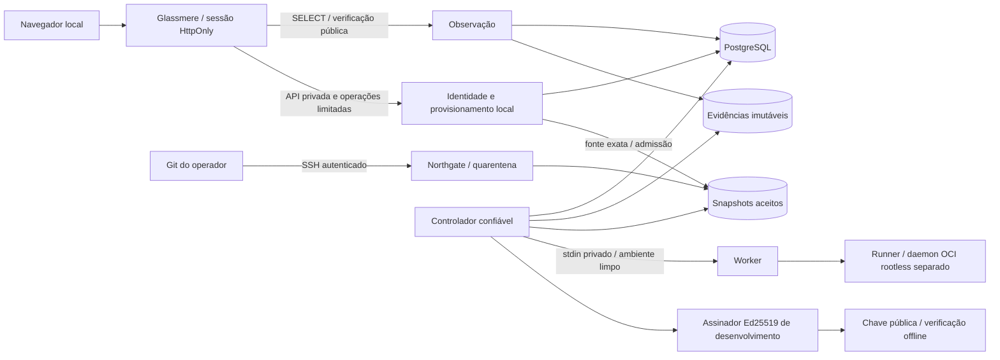

# ArchCert

## Introdução

O ArchCert reúne evidências sobre uma versão exata de um projeto Git, executa
verificações em um ambiente isolado, avalia uma política determinística e pode
assinar um certificado de desenvolvimento. Um fluxo separado pode autorizar um
artefato reproduzível com um Release Permit.

**Classificação desta instalação: LOCAL SELF-HOSTED PILOT — DEVELOPMENT
CERTIFICATION AUTHORITY.** O piloto aceita código real. Não é uma autoridade de
produção nem uma certificação independente. Um resultado favorável vale para o
escopo e as verificações registrados; não prova ausência de vulnerabilidades,
correção universal, segurança de toda dependência ou prontidão para produção.

A identidade certificada contém projeto, repositório, commit completo, árvore Git e
SHA-256 do snapshot imutável. Uma branch pode mudar; essa identidade permanece
exata. Evidências, política, plano e assinatura precisam concordar. Um pedido HTTP
aceito, uma linha no banco ou uma tela saudável não equivalem a um certificado.

O caminho local implementado usa o Glassmere existente, com HTML/CSS/JavaScript
embutidos. A migração para React permanece separada. M9 continua **INCOMPLETE**.

## Arquitetura



O serviço local é uma fronteira de identidade e provisionamento limitada. O painel
continua sem chave privada, socket Docker, credencial Git de aquisição ou banco
com permissão de escrita. O controlador seleciona trabalho durável, lança o worker
e mantém os controles de leases, fencing e limpeza do Stoneward. O worker recebe
fonte/plano e configuração explícita do runtime; não recebe banco, armazenamento de
evidências ou assinatura.

Precisam funcionar simultaneamente: PostgreSQL, serviço local de identidade,
painel, ingresso SSH e supervisor. Para executar e emitir certificados, também são
necessários um daemon rootless independente, imagem aprovada disponível e chave de
desenvolvimento provisionada explicitamente. O controlador roda sob demanda em um
loop supervisionado; o worker é seu processo filho, não outro consumidor do banco.

`archcertd` preserva a API durável e o command broker das instalações provisionadas
externamente. O piloto local usa a mesma admissão de aplicação pelo serviço local;
não precisa iniciar um segundo daemon HTTP. Os brokers de comandos Glassmere,
revisão semântica e builds M6 permanecem operações separadas, não opções fictícias
no assistente local. Veja o [inventário operacional](docs/operations/LOCAL_PILOT.md),
a [arquitetura atual](docs/architecture/CURRENT_ARCHITECTURE_SNAPSHOT.md), o
[ADR 0070](docs/adr/0070-local-pilot-identity-and-provisioning.md) e a
[referência de engenharia preservada](docs/operations/ENGINEERING_REFERENCE.md).

## Requisitos

- Rust **1.99.1**, selecionado por `rust-toolchain.toml`, com Cargo, rustfmt e Clippy.
- Git, Python 3.9 ou posterior, OpenSSH (`ssh`, `ssh-keygen`, `/usr/sbin/sshd`).
  O ingresso usa `/usr/bin/git` e chaves Ed25519.
- Docker CLI e daemon para o PostgreSQL de infraestrutura. Compose não é necessário.
  A imagem PostgreSQL é fixada por digest no launcher.
- Para execução: outro daemon Docker Linux **rootless**, endpoint Unix explícito,
  cgroup v2/systemd, seccomp e suporte aos limites exigidos pelo worker.
- Diretório local privado, fora de repositórios e workspaces de código não confiável,
  com semântica POSIX de lock/fsync. NFS e volumes de rede não estão qualificados.
- Portas de loopback livres: painel `8090`, serviço local `8091`, PostgreSQL `55441`
  e SSH `22223`. `init --port` também reserva a porta seguinte para a API local.

O mecanismo exige pelo menos **1 GiB livre e 1024 inodes disponíveis** nos volumes
verificados de evidências/workspace. Isso é um limite de admissão, não uma medida
de capacidade total. Não há mínimo global de RAM/disco medido para todo o produto;
reserve espaço adicional para toolchain, imagens, código e retenção. Cada hash de
senha usa 64 MiB, com até dois hashes concorrentes.

O caminho macOS/Colima é de **desenvolvimento**, mesmo quando executa e assina.
A qualificação nativa Linux tem uma combinação exata de distribuição, runtime e
mecanismo, descrita em [NATIVE_LINUX_RUNNER.md](docs/qualification/NATIVE_LINUX_RUNNER.md).
Docker Desktop, Podman, outras distribuições e execuções remotas não ganham essa
qualificação por passarem no diagnóstico. Veja também o
[perfil M6](docs/qualification/NATIVE_LINUX_M6_RELEASE.md).

## Instalação do zero

Use a versão entregue deste código. A instalação não reaproveita o banco da prévia
Glassmere nem grava dados permanentes em `target/`.

```bash
git clone https://github.com/cainhooow/pv-archcert.git
cd pv-archcert
git checkout feat/local-self-hosted-pilot
export ARCHCERT_LOCAL_HOME="$HOME/.local/share/archcert-pilot"
./scripts/archcert-local doctor
./scripts/archcert-local init
./scripts/archcert-local up
./scripts/archcert-local status
```

`doctor` verifica ferramentas e o Docker de infraestrutura. `init` compila os
executáveis com o lockfile, cria armazenamento privado, sobe um PostgreSQL dedicado,
aplica migrations explicitamente, separa credenciais de migração/controle/leitura e
prepara o cadastro inicial. Não cria senha padrão nem identidade de assinatura.
`up` supervisiona os serviços; não executa migrations ou reinicializa contas.

Se `8090` já estiver em uso, preserve o serviço existente e escolha uma porta livre:

```bash
./scripts/archcert-local init --port 8094 --database-port 55442 --ssh-port 22224
```

Use a URL informada pelo comando e por `status`. O endereço permanece em
`127.0.0.1`; HTTP local não é apresentado como HTTPS seguro para produção.

## Primeira configuração

1. Abra a URL da instalação. Uma instalação nova redireciona para `/setup`.
2. Em um **terminal local interativo**, obtenha o segredo:

   ```bash
   ./scripts/archcert-local setup-secret
   ```

3. Preencha segredo, nome, email, senha e confirmação no navegador. A senha deve ter
   entre 12 e 128 caracteres; limites e confirmação também são verificados no servidor.
4. Faça login com email e senha. O email é normalizado; a conta inicial tem o papel
   `ADMINISTRATOR`, inicialmente sem projetos.
5. Consulte a seção de infraestrutura em **Local installation** e configure a
   autoridade no host, conforme abaixo. Depois reinicie e volte à página.

O segredo dura 30 minutos. Não o coloque em URL, README, chat, logs ou Git.
`setup-secret` recusa stdout capturado. Para renovar um segredo ainda não consumido:

```bash
./scripts/archcert-local renew-setup
```

O PostgreSQL distingue `UNINITIALIZED`, `SETUP_PENDING`, `INITIALIZED` e
`RECOVERY_REQUIRED`. A transição cria exatamente um administrador, mesmo com
navegadores concorrentes. Depois disso, o cadastro inicial permanece fechado.
Falha de banco, cookie ausente ou reinício não reabrem o formulário. Se uma
publicação de configuração for interrompida, preserve o estado e use `publish`
com os serviços parados; isso reconstrói projeções, não cria outra conta.

### Selecionando a autoridade de desenvolvimento

O perfil local inicial é `python-controlled-local-v1`: usa a família `python`, a
política `archcert-development-v1` e três comandos obrigatórios do contrato
`checks.py typecheck`, `checks.py test`, `checks.py build`. O instalador seleciona a
receita e a imagem; `archcert.toml` do projeto não pode substituí-las. Isso não é
um verificador universal de Python: a força das verificações do projeto e as
limitações do contrato precisam ser interpretadas junto às evidências.

No Linux, selecione o endpoint do daemon rootless previamente provisionado. No
macOS/Colima usado nesta entrega, prepare primeiro o encaminhamento privado do
[guia operacional](docs/operations/LOCAL_PILOT.md#macos--colima-observado) e use
`unix://$HOME/.local/share/archcert-runtime/rootless.sock` como endpoint. Esse caminho
requer o serviço rootless já provisionado na VM separada; uma VM Colima comum não
o substitui. Disponibilize a imagem exata no daemon selecionado:

```bash
case "$(uname -s)" in
  Darwin) export ARCHCERT_RUNTIME_ENDPOINT="unix://$HOME/.local/share/archcert-runtime/rootless.sock" ;;
  Linux) export ARCHCERT_RUNTIME_ENDPOINT="unix:///run/user/$(id -u)/docker.sock" ;;
esac
export ARCHCERT_DOCKER="$(command -v docker)"
"$ARCHCERT_DOCKER" --host "$ARCHCERT_RUNTIME_ENDPOINT" pull \
  python@sha256:70729b46c69b4f1e97c4822c1af3df53a1476cf5ddc6c087c0c10bc3a5678c2f
./scripts/archcert-local configure-authority \
  --image python@sha256:70729b46c69b4f1e97c4822c1af3df53a1476cf5ddc6c087c0c10bc3a5678c2f \
  --development-signing \
  --docker "$ARCHCERT_DOCKER" \
  --endpoint "$ARCHCERT_RUNTIME_ENDPOINT"
./scripts/archcert-local restart
./scripts/archcert-local status
```

`--development-signing` é uma escolha explícita: cria uma chave Ed25519 exclusiva
desta instalação se ainda não existir e seleciona sua chave pública para verificação.
Não rotula essa chave como autoridade de produção. Trocar a imagem de uma instalação
já configurada exige outro perfil/instalação revisado; não se reinterpretam jobs antigos.

No macOS, o endpoint acima não existe. Use um daemon rootless dentro de uma VM
previamente provisionada e um encaminhamento Unix privado. O
[guia operacional](docs/operations/LOCAL_PILOT.md) contém o caminho Colima observado.
O launcher não transforma o daemon comum de infraestrutura em runner e não faz
fallback privilegiado. Sem runtime ou assinatura disponíveis, os pedidos podem
permanecer em fila; a página deve mostrar o bloqueio real.

## Gerenciamento de usuários

| Papel | Acesso |
| --- | --- |
| `VIEWER` | Leitura dos projetos explicitamente atribuídos |
| `OPERATOR` | Leitura e pedidos limitados nos projetos autorizados |
| `REVIEWER` | Leitura; não cria dispensa de política ou autoridade de assinatura |
| `ADMINISTRATOR` | Administração local limitada, criação de novos projetos próprios e auditoria do painel |

Administrador de plataforma não é autoridade de política, runtime, assinatura ou
acesso irrestrito a projetos. Este recorte cria apenas a conta inicial; cadastro de
outras contas, transferência de propriedade e edição de usuários pelo navegador
não estão implementados. Não há opção de interface que prometa essas operações.

Login usa Argon2id; a sessão é opaca, validada no servidor, HttpOnly,
SameSite=Strict e expira após 30 minutos. Logout invalida a sessão. Reinício do
painel exige novo login e preserva a conta. A instalação local usa HTTP, portanto
não usa cookie Secure; o modo HTTPS provisionado externamente preserva Secure.
Tokens não vão para localStorage. Tentativas de autenticação têm orçamento global
no banco e limite de hashes concorrentes.

Recuperação e alterações de papel são comandos do operador do host, auditados:

```bash
./scripts/archcert-local recover-password operator@archcert.local
./scripts/archcert-local set-role operator@archcert.local ADMINISTRATOR
```

A recuperação solicita a nova senha sem eco no terminal, troca geração/credencial
e invalida sessões anteriores. Não reabre setup. O último administrador não pode
ser desabilitado. Para outra conta já provisionada, `set-role EMAIL DISABLED`
revoga o acesso local. Os papéis não criam automaticamente grants de outros serviços.

## Criando um projeto

Em **Local installation**, consulte primeiro infraestrutura e seleção de autoridade.
Crie uma chave de autenticação exclusiva para o repositório, no host:

```bash
ssh-keygen -q -t ed25519 -N '' -f "$ARCHCERT_LOCAL_HOME/bootstrap/project-key"
cat "$ARCHCERT_LOCAL_HOME/bootstrap/project-key.pub"
```

Essa chave privada local sem passphrase depende da proteção do diretório privado;
a chave pública é a única parte colocada no formulário. Ela não entra no snapshot
nem no worker. Para outro repositório, crie outra chave, com outro nome.

Preencha nome, descrição, identificador como `pilot/cent-ledger` e a chave pública.
O backend gera projeto/ator, valida o identificador, grava admissão/grant/auditoria
em transação e publica o registro Northgate. O perfil autorizado é o único
selecionado pelo host. Depois da criação, faça login novamente para adquirir o novo
grant explícito. Alterar uma UUID na URL não concede acesso.

## Configurando Git

O ingresso local suporta **push SSH autenticado**, um commit exato por sessão,
Git SHA-1 e criação de `refs/heads/...`. Não oferece clone remoto, fetch GitHub,
force-update de fonte certificada ou integração GitHub decorativa. O Northgate
preserva separadamente os outros formatos e resoluções já suportados por sua
configuração original. LFS/submódulos sem bytes adquiridos pela autoridade ficam
incompletos e não podem ser executados como fonte completa.

Prepare o cliente com a chave correta e o host key pin gerado na instalação:

```bash
export GIT_SSH_COMMAND="$(./scripts/archcert-local git-config \
  --identity "$ARCHCERT_LOCAL_HOME/bootstrap/project-key")"
```

Na página do projeto, **copie os comandos Git exibidos**: o remote já contém
usuário e UUID reais registrados; a porta está no comando SSH selecionado. Execute-os no seu repositório. Eles usam
`git remote add archcert` e `git push archcert HEAD:refs/heads/candidate`; não
substitua a UUID por uma escolhida manualmente.

Para experimentar um projeto pequeno com funcionalidade e testes reais:

```bash
mkdir -p "$HOME/archcert-ledger"
cp examples/local-ledger/ledger.py examples/local-ledger/checks.py "$HOME/archcert-ledger/"
cd "$HOME/archcert-ledger"
git init --template= --initial-branch=main
git add ledger.py checks.py
git -c user.name='Local operator' -c user.email='operator@archcert.local' \
  commit -m 'Implement integer-cent ledger'
```

Depois execute nesse diretório os dois comandos copiados da página. O exemplo
calcula saldo em centavos e rejeita lançamentos duplicados. Seu `typecheck` é uma
checagem limitada de anotações e tipo de retorno desse contrato, não análise de
tipos de todo programa Python. O build de fonte produz bytecode temporário no
runner; isso **não** é um Release Permit M6.

O onboarding local admite até **16 projetos**. O armazenamento Northgate mantém
o limite existente de **32 sessões retidas**,
inclusive tentativas rejeitadas. Não há coleta automática nem expansão silenciosa
desse limite no piloto. Preserve fontes que sustentam evidências; esgotamento exige
planejamento de retenção/uma nova instalação, não exclusão arbitrária de snapshots.

## Executando uma certificação

1. Atualize **Local installation** depois do push.
2. Confira repositório, submission, commit completo, árvore e SHA-256 do snapshot.
3. Confira política, imagem e plano selecionados pela autoridade na mesma página.
4. Clique em **Request certification of this exact source**.
5. A tela mostra **REQUEST ACCEPTED** e o ID durável do job. Abra o monitoramento.
6. O supervisor chama o controlador existente. Ele reivindica o job no PostgreSQL,
   lança o worker sem credenciais, executa sob rootless OCI e confirma limpeza.
7. Só depois vêm avaliação determinística, persistência e eventual assinatura.

Atualizar a página de resultado não submete novamente. O pedido retém uma chave
de idempotência; duplicatas iguais retornam o mesmo job, entradas diferentes
conflitam. Outro commit gera outra identidade e precisa de outra certificação.

Estados duráveis incluem `QUEUED`, `RUNNING`, `EVALUATING`, `SIGNING`, `COMPLETED`,
`NOT_ELIGIBLE` e `INCONCLUSIVE`. Observe tentativas, falhas e limpeza na página do
job; não interprete `COMPLETED` de uma etapa como emissão do certificado inteiro.
O loop não aumenta orçamentos nem transforma falha de alvo em retry até passar.
Recursos desconhecidos e limpeza incerta continuam bloqueando execução.

## Resultados, evidências e certificados

| Resultado de regra | Interpretação |
| --- | --- |
| `PROVEN` | A propriedade limitada foi estabelecida pelas evidências aceitas |
| `FAILED` | Evidência aceita contradiz a propriedade exigida |
| `NOT_PROVEN` | Evidência insuficiente para estabelecer a propriedade |
| `NOT_APPLICABLE` | A regra não se aplica dentro do escopo declarado |
| `INCONCLUSIVE` | Infraestrutura ou observação não permitem conclusão segura |

Elegibilidade é uma etapa ainda sem assinatura. Um certificado legítimo exige
payload canônico, identidades concordantes, chave pública selecionada e assinatura
verificada. O Glassmere separa metadados, disponibilidade dos bytes e verificação.
Inspecione identidade do certificado, fonte/política, digest das evidências,
identidade da chave e instante de emissão registrado no payload.

Nas páginas do job/projeto, abra as evidências e o certificado registrado. Downloads
são anexos de bytes originais com digest e autorização de projeto. Preserve as
omissões e os resultados negativos; uma resposta semântica `CONTINUE` não produz
propriedades determinísticas. Evidência pode conter informação confidencial do
código; não publique o armazenamento privado.

## Verificação offline

Baixe o envelope original do certificado pelo painel. Selecione a chave pública
provisionada no host, sem confiar apenas na chave embutida no envelope:

```bash
"$ARCHCERT_LOCAL_HOME/bin/archcert" verify certificado.json \
  --public-key "$ARCHCERT_LOCAL_HOME/public/source.hex"
```

O nome `certificado.json` representa o arquivo que você acabou de baixar; o painel
usa nomes baseados no digest. O comando trabalha sem PostgreSQL, controlador,
worker ou daemon OCI. Verifica assinatura e identidade sob a chave selecionada;
não estabelece revogação, expiração ou confiança de produção nessa chave.

## Builds e Release Permits

Certificação de fonte não autoriza automaticamente um binário. O M6 existente
usa fonte e certificado exatos, receita Rust da autoridade, builds A/B independentes,
comparação dos bytes, digest do arquivo e Release Permit separado. Seu escopo
qualificado é um único arquivo regular, com receita e ambiente documentados.

O assistente local Python mostra M6 como **UNSUPPORTED**. Não oferece shell recipes
nem simula `BUILD COMPLETED` ou `RELEASE PERMITTED`. Para o fluxo M6 já implementado,
use o [guia de release](docs/release/README.md) e a qualificação correspondente. O
comando offline existente é `archcert release-gate`; execute seu `--help` para os
argumentos exatos e selecione explicitamente a chave de release, artefato, projeto
e repositório. Uma build admitida não é autorização de deploy.

## Operação diária

```bash
./scripts/archcert-local up
./scripts/archcert-local status
./scripts/archcert-local logs
./scripts/archcert-local down
./scripts/archcert-local restart
```

`status` consulta `/healthz`, `/readyz` e a observação recente do supervisor.
`READY`, `CONFIGURATION_REQUIRED`, `UNAVAILABLE`, `UNQUALIFIED` e `ERROR` têm
significados distintos. Saúde do processo não significa que é possível certificar.
No macOS, runtime utilizável continua `UNQUALIFIED` para qualificação nativa.
`logs` mostra os caminhos privados; inspecione os arquivos localmente.

`down` encerra somente os processos e o PostgreSQL identificados desta instalação.
Não apaga dados, gates ou recursos OCI desconhecidos. Um processo interrompido
pode exigir a reconciliação conservadora já documentada em
[Ravenport operations](docs/architecture/RAVENPORT_OPERATIONS.md).

## Backup e restauração

Pare a instalação para uma cópia consistente. O backup exige jobs quiescentes;
execução/avaliação/assinatura em andamento precisam de investigação/reconciliação
antes. O comando sobe apenas o banco para `pg_dump` e o para ao terminar:

```bash
./scripts/archcert-local down
./scripts/archcert-local backup
```

A pasta impressa contém dump PostgreSQL, snapshots, artefatos imutáveis, cadastro
Git, configurações privadas, auditoria, gates retidos e custódia das chaves. Ela
contém **segredos reais** e precisa de proteção/cópia externa sob sua responsabilidade.
Backup apenas do PostgreSQL não preserva uma autoridade utilizável. Hashes do
manifesto detectam alteração de conteúdo; não autenticam uma origem de backup.

Restaure em **outro diretório vazio**, selecionando a pasta privada impressa:

```bash
export ARCHCERT_BACKUP="$(ls -dt "$ARCHCERT_LOCAL_HOME"/backups/backup-* | head -1)"
./scripts/archcert-local --home "$HOME/.local/share/archcert-restored" restore \
  --backup "$ARCHCERT_BACKUP" --port 8096 --database-port 55443 --ssh-port 22225
./scripts/archcert-local --home "$HOME/.local/share/archcert-restored" up
./scripts/archcert-local --home "$HOME/.local/share/archcert-restored" status
```

A restauração verifica os arquivos, preserva a identidade durável e as evidências,
cria credenciais de infraestrutura próprias e reconstrói projeções locais. Não
restaura automaticamente autorização de execução: revise gates/runtime e configure
explicitamente o ambiente antes de processar jobs. Não remova tombstones ou limpe
claims para liberar trabalho. Verifique certificados restaurados offline.

## Atualização do ArchCert

Faça backup completo e retenha a versão instalada. Em seguida, selecione no Git
uma versão revisada e execute, com os serviços parados:

```bash
./scripts/archcert-local update
./scripts/archcert-local up
./scripts/archcert-local status
```

`update` compila com o lockfile, aplica migrations com a credencial separada e
instala executáveis/configurações. Uma falha mantém um marcador que bloqueia `up`
até concluir a atualização. O manifesto privado registra commit, estado de trabalho
e digests dos binários. Retorne apenas a uma versão comprovadamente compatível;
não faça downgrade destrutivo sobre banco já migrado. Restaurar backup completo em
outra instalação é diferente de executar migrations antigas sobre o banco atual.

## Solução de problemas

| Sintoma | Diagnóstico e ação |
| --- | --- |
| PostgreSQL indisponível | `status`; verifique o Docker de infraestrutura e o container identificado no manifesto privado; retome com `up`. Não rode `init` sobre a instalação existente. |
| Porta ocupada | Escolha portas livres em uma instalação nova; preserve a prévia antiga. `init` recusa conflitos. |
| Setup falhou/expirou | Confira estado durável e disponibilidade do banco. `renew-setup` só funciona antes da inicialização. Após inicializar, use recuperação de conta. |
| `RECOVERY_REQUIRED` | Preserve banco/configuração/auditoria. Corrija dependências e, para publicação interrompida, execute `publish` com serviços parados. Nunca apague o banco para reabrir cadastro. |
| Senha esquecida | `recover-password EMAIL` no terminal local autorizado; login novamente após a recuperação auditada. |
| Login inválido ou limitado | Confira email/senha; aguarde a janela do orçamento global. Reiniciar não apaga o limite durável. |
| Git sem autenticação | Use a chave privada correspondente à pública registrada e o resultado de `git-config --identity`. Confira host pin, porta e logs SSH privados. |
| Repositório/commit inválido | Use o remote registrado e `HEAD:refs/heads/candidate`; confira SHA-1 e o commit completo. Tags, deleção, atualização de ref antiga e objetos inválidos são recusados. |
| Fonte aceita ausente | Confira saída Northgate e a página após refresh. LFS/submódulos podem deixar a fonte incompleta. O ID de uma fonte não concede autorização. |
| Runner/Docker rootless ausente | Consulte a observação do worker doctor; confirme o endpoint independente. Não use o socket comum nem modo privilegiado como fallback. |
| Assinatura não configurada | Execute a seleção explícita `configure-authority --development-signing` no host e reinicie. Não copie chaves para o painel ou runner. |
| Job permanece pendente | Confira runtime, imagem, assinatura e log do controlador. A fila sobrevive a reinícios; painel saudável não prova processamento. |
| Evidência ausente/corrompida | Metadados não substituem bytes; restaure a cópia completa e investigue. Não fabrique objetos nem altere digests. |
| Readiness negada | Leia os bloqueios exatos e a identidade observada. Um certificado de fonte ou recibo antigo não satisfaz o gate M6. |
| Migration/update falhou | Preserve o marcador e logs privados; corrija o requisito e repita a mesma atualização. Não edite migrations históricas/checksums nem faça downgrade do banco. |
| Perfil não suportado | O onboarding aceita apenas o perfil Python descrito. Rust controlado, revisão semântica e M6 usam os fluxos operacionais existentes. |

## Segurança e limitações

Dados locais são privados, mas não criptografados em repouso pelo adaptador de
armazenamento. Mesma UID/root, administrador do banco e administrador do runtime
continuam no contexto confiável de desenvolvimento. Separação de dependências e
processos não é proteção contra comprometimento total desse host. O endpoint não
é público; TLS/identidade/custódia de produção exigem outro provisionamento revisado.

O piloto não inicia M10, M11, Pre-Genesis ou Genesis. Não acrescenta suporte universal
a linguagens, coleta externa de dependências, garantia contra escape, IAM empresarial,
revogação/expiração de certificados ou recuperação de power loss qualificada. Consulte
os [modelos de ameaça](docs/threat-model/) e as [decisões arquiteturais](docs/adr/).

> This is engineering self-validation under a shared implementation/authority context. It is not independent certification and does not replace Genesis / Firstwarden.

## Referência de comandos

| Comando | Função |
| --- | --- |
| `doctor` | Ferramentas e Docker de infraestrutura |
| `init` | Nova instalação, migrations explícitas e setup privado |
| `up`, `down`, `restart` | Ciclo de vida da instalação selecionada |
| `status`, `logs` | Saúde observada e caminhos dos logs privados |
| `setup-secret`, `renew-setup` | Entrega local/renovação de segredo não consumido |
| `configure-authority` | Perfil/imagem e seleção explícita de custódia/runtime |
| `git-config --identity PATH` | Comando SSH com host pin e chave selecionada |
| `recover-password EMAIL` | Recuperação auditada no host |
| `set-role EMAIL ROLE` | Alteração auditada e invalidação de sessões |
| `publish` | Reconstrução de projeções a partir do estado durável |
| `backup`, `restore --backup PATH` | Cópia completa quiescente e restauração isolada |
| `update` | Compilação, migration explícita e atualização controlada |

Use `./scripts/archcert-local --help` e os `--help` dos subcomandos. O argumento
global `--home` ou `ARCHCERT_LOCAL_HOME` escolhe uma instalação privada; não é uma
opção de projeto nem de código executado no runner.

## Desenvolvimento e testes

Os sete gates padrão são:

```bash
cargo fmt --check
cargo check --workspace --all-targets --all-features --locked
cargo clippy --workspace --all-targets --all-features --locked -- -D warnings
cargo test --workspace --locked
RUSTDOCFLAGS="-D warnings" cargo doc --workspace --no-deps --locked
cargo deny check
./scripts/check-architecture
```

Testes ignorados não contam como execução. PostgreSQL real é necessário para
concorrência/recuperação: `scripts/test-ravenport` e os testes opt-in de
`archcert-local-api` criam schemas isolados com a URL de teste provisionada fora do
repositório. `scripts/test-northgate` usa SSH real. `scripts/test-live-oci` exige
Docker/endpoint/imagem explícitos. Os grupos históricos, revisão/journal, protocolos,
artefatos e M6 mantêm seus escopos e pré-requisitos próprios.

A automação de navegador usa somente as dependências de teste travadas em
`tools/glassmere-browser` e Chrome selecionado explicitamente. Não há Node no
produto em execução. O teste `scripts/test-local-pilot-browser` requer uma instalação
nova dedicada, `ARCHCERT_LOCAL_HOME`, `ARCHCERT_LOCAL_TEST_OUTPUT` sob `target/` e,
quando necessário, `GLASSMERE_CHROME_EXECUTABLE`. Não publique seu diretório privado.

Resultados executados, contagens, falhas e limites desta entrega ficam no
[registro operacional de aceitação](docs/operations/LOCAL_PILOT.md). Evidências
transitórias ficam em `target/local-pilot/`; certificados históricos continuam
vinculados aos seus commits originais. Esta entrega não declara autocertificação
do novo código do ArchCert apenas por compilar ou certificar o projeto de exemplo.

## Roadmap

| Marco | Estado e escopo |
| --- | --- |
| M5.2 Stoneward | COMPLETE no perfil exato documentado |
| M6 Ironcrest | COMPLETE no escopo nativo de arquivo único; assinatura de desenvolvimento |
| M7 Asterwyn | COMPLETE no escopo determinístico limitado dos ADRs 0045/0049 |
| M8 Greywatch | COMPLETE no escopo suplementar limitado dos ADRs 0045/0050 |
| M9 Glassmere | INCOMPLETE / IN PROGRESS; o piloto local não constitui fechamento |
| M10 Crownvale | NOT STARTED |
| M11 Thornwick | NOT STARTED |
| Pre-Genesis | NOT STARTED |
| Genesis / Firstwarden | NOT STARTED |

[ADR 0045](docs/adr/0045-roadmap-reconciliation.md) reconcilia nomes e escopos.
Identificadores históricos `ironcrest` permanecem compatíveis e não provam, por si,
conclusão de um marco canônico.
