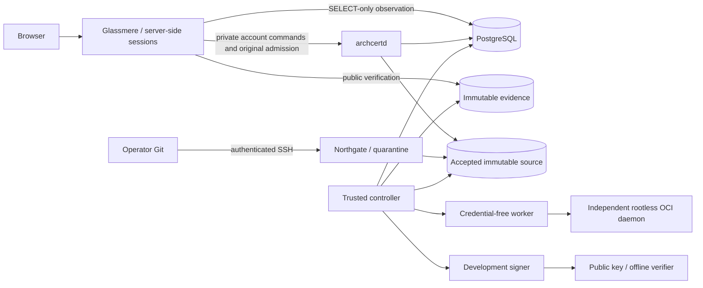

# ArchCert

ArchCert certifies an exact Git source identity against authority-selected checks
and a deterministic policy. It retains execution evidence, findings and verdicts,
and issues a development certificate only when issuance requirements are met.
A separate M6 lifecycle binds reproducible artifacts to Release Permits.

Running on localhost runs **the existing ArchCert application**. Glassmere is its
web panel; `archcertd` is its API. There is no local edition or second certification
backend. The deployment described here is a **DEVELOPMENT CERTIFICATION AUTHORITY**.
It processes real source but is not a production authority or independent certifier.
Passing bounded checks does not prove universal correctness or absence of flaws.

A certification binds project, repository, full commit OID, Git tree, immutable
snapshot digest, policy, plan and evidence. A moving branch, successful HTTP
request or database row is not a certificate. `archcert.toml` remains untrusted and
cannot weaken mandatory authority requirements.

## Architecture



PostgreSQL, `archcertd`, `archcert-panel`, OpenSSH/Northgate and the supervisor run
throughout use. The supervisor invokes the original controller's `run-once` loop;
the controller claims durable work and starts the original worker on demand.
Execution also requires an independently provisioned rootless daemon, pinned image
and explicit authority configuration. Signing requires explicit development key
provisioning. A healthy panel alone does not establish execution readiness.

The panel receives SELECT-only observation, a bounded private API credential and
public trust keys. It receives no password hashes, signing keys or Docker socket.
The worker receives no database, acquisition credentials or signing authority.
Leases, fencing, recovery gates and uncertain cleanup retain Stoneward semantics.
See the [service inventory](docs/operations/DEPLOYMENT.md),
[current architecture](docs/architecture/CURRENT_ARCHITECTURE_SNAPSHOT.md),
[ADR 0071](docs/adr/0071-product-account-integration.md),
[security model](docs/threat-model/PLATFORM_SETUP.md) and
[preserved engineering reference](docs/operations/ENGINEERING_REFERENCE.md).

## Requirements

- Rust **1.99.1**, Cargo, rustfmt and Clippy, selected by `rust-toolchain.toml`.
- Git, Python 3.9+, OpenSSH (`ssh`, `ssh-keygen`, `/usr/sbin/sshd`). The current
  ingress uses `/usr/bin/git` and Ed25519 keys.
- Docker CLI and an infrastructure daemon for PostgreSQL. The helper pins its image
  by digest. Compose is not required.
- For target execution: a separate Linux **rootless** Docker daemon with Unix
  endpoint, cgroup v2/systemd, seccomp and enforced runner limits. Provision it
  using the [Docker rootless guide](https://docs.docker.com/engine/security/rootless/)
  and the [qualified runner profile](docs/qualification/NATIVE_LINUX_RUNNER.md).
  `init` does not install or replace that daemon.
- Private local POSIX filesystem outside target repositories, with locks/fsync.
  Network filesystems are unqualified. The mechanism requires at least 1 GiB free
  and 1024 available inodes on checked stores; this is an admission floor, not a
  measured whole-product capacity recommendation. Allow additional space for Rust,
  images, source and evidence retention. No global RAM/disk minimum is claimed.
  Argon2id uses 64 MiB per hash, at most two concurrently in the API.
- Free loopback ports: panel `8090`, API `8091`, PostgreSQL `55441`, SSH `22223`.

macOS/Colima can exercise development workflows using a private forward to an
independent rootless daemon in Linux. It does **not** establish native Linux
qualification. Other OS/runtime combinations require their own qualification.
See [macOS operations](docs/operations/DEPLOYMENT.md#macos-and-colima) and the
[exact M6 Linux scope](docs/qualification/NATIVE_LINUX_M6_RELEASE.md).

## Install from a fresh clone

```bash
git clone https://github.com/cainhooow/pv-archcert.git
cd pv-archcert
git checkout fix/existing-product-deployment
export ARCHCERT_HOME="$HOME/.local/share/archcert"
./scripts/archcert-services doctor
./scripts/archcert-services init
./scripts/archcert-services up
./scripts/archcert-services status
```

Select the infrastructure Docker context before `init` if necessary, for example
`export DOCKER_CONTEXT=colima`. The helper records it independently of the execution
endpoint. `init` builds the actual workspace executables with the lockfile, creates
private persistent stores, starts dedicated PostgreSQL, explicitly migrates it,
separates migration/control/observation credentials and authorizes initial setup.
It creates no default password or signing identity. `up` starts services without
migrating or initializing accounts. Data does not live in repository `target/`.

If ports are occupied, preserve the existing services and initialize a different
empty installation with explicit ports, for example:

```bash
./scripts/archcert-services init --port 8094 --database-port 55442 --ssh-port 22224
```

The API uses the next port after the panel. Use the URL reported by `status`.
The helper binds loopback only; HTTP is a development transport, not production TLS.

## First administrator and initial configuration

1. Open `http://127.0.0.1:8090` (or the selected port). Fresh deployments show setup.
2. Obtain the setup secret in a **local interactive terminal**:

   ```bash
   ./scripts/archcert-services setup-secret
   ```

3. Enter the secret, display name, email, password and confirmation. The server
   validates email uniqueness, input limits and a 12–128-character password.
4. Sign in with email/password. The initial account is `ADMINISTRATOR`, with no
   existing project access. Open **ArchCert platform** to inspect infrastructure.
5. Select development authority on the host as below; restart and inspect readiness.

The secret expires after 30 minutes and is never put in a URL. The command refuses
captured output. Do not share it in chat, Git or logs. `renew-setup` renews only an
unconsumed setup secret. PostgreSQL durably distinguishes `UNINITIALIZED`,
`SETUP_PENDING`, `INITIALIZED` and `RECOVERY_REQUIRED`; concurrent registration
creates exactly one administrator. Setup closes after initialization. An outage,
missing cookie or restart cannot reopen it. Interrupted publication requires
explicit recovery, not another initial account.

The bounded onboarding plan uses the existing `python` family and development
policy, with mandatory `checks.py typecheck`, `checks.py test`, `checks.py build`.
The host selects the recipe and pinned image. This contract is not a universal
Python correctness proof; interpret project-authored checks and omissions honestly.
For the included cent ledger, the tests exercise real business behavior.

First provision the rootless daemon. On Linux its usual endpoint is
`unix:///run/user/$(id -u)/docker.sock`; use the actual selected endpoint. On the
observed macOS host, use the private forward described in the operations guide:

```bash
case "$(uname -s)" in
  Darwin) export ARCHCERT_RUNTIME_ENDPOINT="unix://$HOME/.local/share/archcert-runtime/rootless.sock" ;;
  Linux) export ARCHCERT_RUNTIME_ENDPOINT="unix:///run/user/$(id -u)/docker.sock" ;;
esac
export ARCHCERT_DOCKER="$(command -v docker)"
"$ARCHCERT_DOCKER" --host "$ARCHCERT_RUNTIME_ENDPOINT" pull \
  python@sha256:70729b46c69b4f1e97c4822c1af3df53a1476cf5ddc6c087c0c10bc3a5678c2f
./scripts/archcert-services configure-authority \
  --image python@sha256:70729b46c69b4f1e97c4822c1af3df53a1476cf5ddc6c087c0c10bc3a5678c2f \
  --development-signing --docker "$ARCHCERT_DOCKER" \
  --endpoint "$ARCHCERT_RUNTIME_ENDPOINT"
./scripts/archcert-services restart
./scripts/archcert-services status
```

`--development-signing` explicitly creates one installation-specific Ed25519 key
if absent and selects its public trust key. It grants no production trust. Image
changes on an already selected installation are rejected; historical jobs cannot
be silently reinterpreted. Without runtime/signing prerequisites, readiness reports
the blocker and eligible requests may remain queued. No privileged fallback exists.

## Accounts and sessions

| Role | Bounded access |
| --- | --- |
| `VIEWER` | Read explicitly assigned projects |
| `OPERATOR` | Read and bounded certification requests in assigned projects |
| `REVIEWER` | Read; no policy waiver or signing authority |
| `ADMINISTRATOR` | Delegated creation of new owned projects and panel audit |

Platform administration is independent of policy, runtime, signing and cross-project
authority. Additional account registration, ownership transfer and browser user
editing are currently unavailable. Existing externally provisioned bearer accounts
remain supported under [Glassmere provisioning](docs/glassmere/PROVISIONING.md).

Password mode extends the same Glassmere authentication/authorization/session engine.
Argon2id hashes stay in PostgreSQL. Sessions are opaque, validated server-side,
HttpOnly, SameSite=Strict and expire after 30 minutes; logout invalidates them.
Current account generation and grants are rechecked. Panel restart ends sessions,
not accounts. HTTPS mode uses Secure cookies; this loopback HTTP deployment does
not. No token is stored in localStorage. A persistent shared login budget and
bounded hashing limit brute force; waiting for its minute window may be necessary.

Audited host recovery and role changes invalidate previous sessions:

```bash
./scripts/archcert-services recover-password operator@example.com
./scripts/archcert-services set-role operator@example.com VIEWER
```

Recovery prompts privately with confirmation; no password goes in argv. Role changes
may use VIEWER, OPERATOR, REVIEWER, ADMINISTRATOR or DISABLED. The final enabled
administrator cannot be disabled/demoted. These commands do not create accounts.

## Create a project and register Git

Create an Ed25519 key outside target source. Use a separate key per registration:

```bash
ssh-keygen -t ed25519 -f "$ARCHCERT_HOME/bootstrap/project-key"
cat "$ARCHCERT_HOME/bootstrap/project-key.pub"
```

In **ArchCert platform**, enter project name `Cent ledger`, description,
repository identifier `pilot/cent-ledger` and that public key. The backend generates
the project UUID and transactionally creates the owned project, repository grant
and audit. The profile is selected on the host, not supplied by the browser.
Publication changes assignments, so sign in again when redirected.

Copy the **exact registered remote** from the project screen. It contains the
actual project UUID and SSH user; do not invent a UUID or reuse another deployment's
remote. Configure the pinned SSH connection and push your real project:

```bash
export GIT_SSH_COMMAND="$(./scripts/archcert-services git-config \
  --identity "$ARCHCERT_HOME/bootstrap/project-key")"
git remote add archcert "$ARCHCERT_REGISTERED_REMOTE"
git push archcert HEAD:refs/heads/candidate
```

Set `ARCHCERT_REGISTERED_REMOTE` to the complete value shown on your project page
before those commands. This is an installation-specific value, not a fixed endpoint.
For a first supported example, copy `examples/cent-ledger/ledger.py` and `checks.py`
into a new Git repository outside ArchCert, commit both, then run the commands.
A passphrase-protected key uses ordinary SSH-agent/terminal authentication.

Only authenticated push is exposed here. Northgate validates protocol, bounded
packs, repository identity and exact objects through quarantine before acceptance.
Onboarding uses SHA-1 Git repositories; no arbitrary web `git clone`, GitHub import,
remote credentials, submodule fetching or LFS acquisition is offered. Refer to
[Northgate](docs/source-ingress/README.md) for its full contract.

## Request and inspect certification

Refresh **ArchCert platform** after pushing. Accepted-source entries show full
commit, tree and immutable snapshot identities, plus the authority policy/plan.
Review the exact entry and request certification. The response says **REQUEST
ACCEPTED** and links a durable job; it does not claim a pass. Repeated requests for
the same source use retained idempotency. A modified commit is a distinct source
and requires distinct certification.

Follow the job link. The controller records actual queue/attempt/lease states,
worker evidence and errors. Source is read-only, runtime networking is denied and
limits are authority-selected. Inspect evidence rows, original bytes and findings;
completed execution alone does not authorize issuance. An infrastructure failure,
uncertain cleanup or unresolved gate remains visible and may require operator
reconciliation under [Ravenport operations](docs/architecture/RAVENPORT_OPERATIONS.md).
Never delete unknown containers or retry until a desirable verdict appears.

| Property result | Meaning |
| --- | --- |
| `PROVEN` | Required evidence establishes this bounded property |
| `FAILED` | Evidence contradicts the requirement |
| `NOT_PROVEN` | Evidence does not establish the property |
| `NOT_APPLICABLE` | Explicitly outside the applicable requirement |
| `INCONCLUSIVE` | Failure/uncertainty prevents a reliable conclusion |

Overall eligibility and individual property results differ. `NOT_ELIGIBLE` is not
an issued certificate. When legitimately issued, open the CERTIFICATE evidence,
inspect project/repository, commit/tree/snapshot, policy, verdict, evidence digest,
key identity and signature verification, then download original bytes. A missing
certificate or invalid signature must never be treated as certification.

## Offline verification

Select the installation's public key independently; download the certificate to
`certificate.json` in your current directory. The verifier requires neither database,
runtime nor private signing key:

```bash
"$ARCHCERT_HOME/bin/archcert" verify certificate.json \
  --public-key "$ARCHCERT_HOME/public/source.hex"
```

Require `CERTIFIED` and a valid signature under the intended trusted key. A public
key's mere presence does not establish trust. Development signatures remain
engineering artifacts even when verification succeeds.

## Builds and Release Permits

Source certification does not authorize an artifact. M6 requires exact source
certificate, an authority-owned recipe, independent A/B builds, reproducibility
evidence, artifact digest, Release Permit and offline deployment gate. Current
project onboarding marks M6 **UNSUPPORTED**; it exposes no arbitrary shell recipe.
Use the separate [M6 operations](docs/release/README.md) only within its exact
single-file native Linux scope. Original opt-in command-broker workflows remain
available under their existing provisioning, not implied by account setup.

## Daily operation

```bash
./scripts/archcert-services status
./scripts/archcert-services logs
./scripts/archcert-services down
./scripts/archcert-services up
./scripts/archcert-services restart
```

`status` distinguishes process inventory and timestamped dependency observations;
`logs` shows private installation log locations. Read the platform page for
READY, CONFIGURATION_REQUIRED, UNAVAILABLE, UNQUALIFIED or ERROR. `down` stops only
owned native processes and its dedicated database, preserving data; shared rootless
daemons/forwards remain separately operated. `up` is the start command.

## Backup, restore and upgrade

```bash
./scripts/archcert-services down
./scripts/archcert-services backup
export ARCHCERT_BACKUP="/absolute/path/reported/by/backup"
./scripts/archcert-services --home "$HOME/.local/share/archcert-restored" restore \
  --backup "$ARCHCERT_BACKUP" --port 8096 --database-port 55443 --ssh-port 22225
./scripts/archcert-services --home "$HOME/.local/share/archcert-restored" up
```

`backup` requires stopped services, dumps PostgreSQL and retains source, artifacts, Git,
private configuration, public trust, signing custody, audit and runtime gates.
The printed directory is private and includes credentials/keys: protect it off-host;
never commit it. Database backup alone is insufficient. Restoration requires a new
empty home/database/ports, verifies checksums, restores exact records and applies
forward migrations. Runtime execution remains disabled until explicit host review
and reconfiguration. Old gates are not permission to run on a new host. Verify
retained certificates offline before resuming. Checksums detect corruption, not
malicious replacement by a trusted backup owner.

Before upgrading, inspect release/schema compatibility and make a complete backup:

```bash
./scripts/archcert-services down
./scripts/archcert-services backup
git fetch origin
git checkout fix/existing-product-deployment
git pull --ff-only
./scripts/archcert-services update
./scripts/archcert-services up
./scripts/archcert-services status
```

`update` requires stopped services, builds selected committed source, explicitly
migrates and publishes projections. It records executable digests/source. An
interrupted update blocks startup. Never downgrade executables over a migrated
metadata database. Roll back by restoring the complete compatible backup into a
separate installation. Legacy deployment paths require `--home` explicitly;
update migrates their configuration in place without reopening account creation.

## Troubleshooting

| Symptom | Diagnosis and action |
| --- | --- |
| PostgreSQL unavailable | Check selected Docker context/container and private logs; restore connectivity. Setup must remain closed. |
| Failed migration or corrupt configuration | Preserve files and pending markers. Investigate version/checksum and logs; use explicit update/recovery, never delete the database. |
| Onboarding denied/expired | Use the correct loopback Origin and local secret; renew only before initialization. INITIALIZED requires normal login. |
| Forgotten password | Use audited `recover-password` locally. It cannot reopen bootstrap. |
| Port conflict | Choose distinct free ports on a new empty installation; preserve existing services. |
| Git authentication failure | Use the registered key, exact remote, generated SSH options and pinned host key; inspect ingress logs. |
| Invalid commit/missing accepted source | Push a complete supported Git object graph through Northgate; a local branch alone is not accepted source. |
| Rootless daemon unavailable | Inspect the independently provisioned endpoint and worker doctor; infrastructure Docker is not the runner. |
| Missing signing identity | Explicitly provision development signing; the panel cannot supply a private key. |
| Job pending | Inspect actual controller/runtime/signing observations and durable gates, not just panel liveness. |
| Missing evidence | Inspect artifact-store readiness and durable publication state. Never fabricate or replace evidence. |
| Readiness denied | Resolve exact identity, profile, fence and dependency blockers; a receipt is not deployment authorization. |
| Unsupported profile/build | Use the documented qualified profile; no arbitrary target recipe or automatic fallback exists. |

## Security, development and roadmap

All target bytes, including tests/configuration/instructions, remain untrusted.
No target selects policy, image, runtime, limits, signing or disclosure authority.
The current helper uses same-UID/root trusted custody, private unencrypted files
and loopback HTTP. It is not a hostile multi-tenant or production IAM deployment.
External import, browser account administration, arbitrary languages/builds,
production keys and React modernization are outside this delivery.

For executable command syntax use `./scripts/archcert-services --help`, its
subcommand `--help`, and `"$ARCHCERT_HOME/bin/archcert" --help`. Additional helper
commands are `publish`, `renew-setup`, `setup-secret`, `git-config`,
`configure-authority`, `recover-password`, `set-role`, `backup`, `restore`, `update`.
The internal `__supervise` entrypoint is not an operator workflow.

Engineering gates are `cargo fmt --check`, workspace check/clippy/test with
`--locked`, rustdoc with warnings denied, `cargo deny check` and
`./scripts/check-architecture`; see [AGENTS.md](AGENTS.md). Real PostgreSQL,
Northgate SSH, controller crash/recovery and independently provisioned rootless OCI
regressions are opt-in and cannot be replaced by mocks. Browser acceptance uses
`scripts/test-archcert-onboarding` and `scripts/test-archcert-certification` with a
separate fresh installation and real Chrome, as documented in the operations guide.
Passing engineering gates does not establish production or independent assurance.

[ADR 0045](docs/adr/0045-roadmap-reconciliation.md) remains authoritative:
M5.2 Stoneward and M6 Ironcrest are COMPLETE only in their exact qualification
scopes; M7 Asterwyn and M8 Greywatch are COMPLETE in their bounded recorded scopes.
**M9 Glassmere remains INCOMPLETE / IN PROGRESS. M10 Crownvale, M11 Thornwick,
Pre-Genesis and Genesis / Firstwarden are NOT STARTED.**

> This is engineering self-validation under a shared implementation/authority context. It is not independent certification and does not replace Genesis / Firstwarden.

Advanced contracts remain in [Glassmere](docs/glassmere/README.md),
[provisioning](docs/glassmere/PROVISIONING.md),
[self-validation](docs/self-validation/README.md), [ADRs](docs/adr/),
[threat models](docs/threat-model/) and the
[engineering reference](docs/operations/ENGINEERING_REFERENCE.md).
